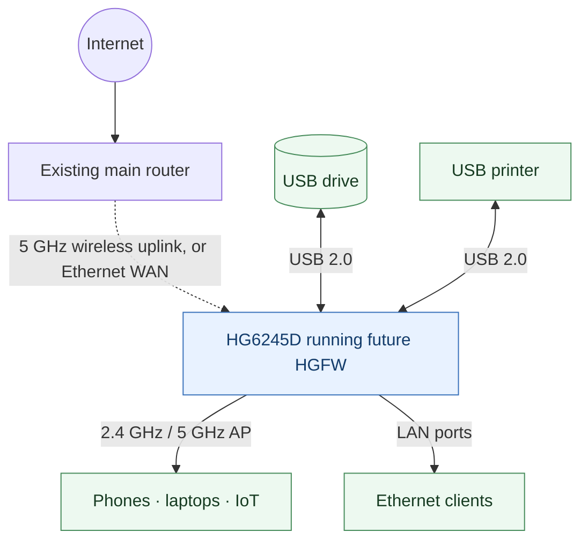
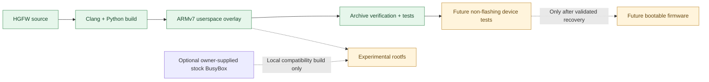

# HGFW — HG6245D Custom Firmware

[](https://github.com/Kyne0328/pldt-hd6245d-custom-firmware/actions/workflows/ci.yml)

**An open, community-oriented firmware project to repurpose the FiberHome HG6245D as a capable router and network appliance.**

The aim is to use as much of the device's existing hardware as possible: dual-band Wi-Fi, Ethernet routing, USB storage, printer sharing, and an independent administration interface.

> [!IMPORTANT]
> **Early development — not ready to install.** The repository currently builds an ARMv7 userspace test executable and a small, reproducible filesystem overlay. It does **not** contain a bootable kernel, a working replacement router firmware, or a flashable image. Do not flash any of the generated archives to your device.

## The goal



This diagram is the **planned system**, not an assertion that the current code already implements these connections. GPON operation is optional because the project targets retired/deactivated units.

### Target hardware

| Component | Findings |
| --- | --- |
| Device | FiberHome HG6245D, RP2613 hardware/firmware variant |
| SoC | Broadcom BCM96846 (`brcm,bcm96846` device-tree compatible) |
| CPU / OS baseline | ARMv7, original Broadcom Linux 4.1.45 |
| RAM | Approximately 208 MiB visible to the stock Linux kernel |
| Wi-Fi | 2.4 GHz and 5 GHz Broadcom radios; AP mode verified, client capability advertised but not yet tested end-to-end |
| Ethernet | Four LAN ports; switch and per-port routing still to be validated |
| USB | Two physical ports verified to enumerate a removable USB mass-storage device at USB 2.0 high-speed |
| Flash | NAND / UBI / UBIFS with two firmware slots; bootloader and safe recovery behavior not yet established |

Hardware capabilities verified on one board are not necessarily identical across all ISP/manufacturing variants.

## Progress

| Area | Status |
| --- | --- |
| Original firmware preservation / hardware investigation | Completed locally; private backups **not included** here |
| ARMv7 cross-compilation | Working |
| Reproducible userspace overlay + checksums | Working |
| Offline test suite | Working |
| Temporary execution on the actual router | Not yet tested |
| Ethernet WAN, firewall, DHCP and DNS | Planned |
| Wireless client / repeater modes | Under investigation |
| SMB/NAS file sharing | Planned |
| USB printer server | Planned; requires printer compatibility testing |
| Independent admin UI | Planned |
| Bootable custom image / safe installer | Blocked by boot-chain and recovery validation |

## Architecture and development path



A complete modern Linux/OpenWrt-style port is the long-term direction. Broadcom's proprietary wireless/switching dependencies make modern-kernel support a substantial engineering challenge. A compatibility userspace on the original kernel is a development stepping stone—not a secure, finished firmware release.

## Build

**Requirements:** Linux or WSL2, Python 3.9+, GNU Make, Bash, Clang with ARM target support, and LLD. On Ubuntu 24.04:

```bash
sudo apt-get install -y python3 make clang lld
git clone https://github.com/Kyne0328/pldt-hd6245d-custom-firmware.git
cd pldt-hd6245d-custom-firmware
make all
```

`make all` builds and verifies the **original-source-only** stage-1 overlay, then runs its tests. This is entirely an offline host build, and does not connect to or modify a router.

The outputs are generated under `dist/`:

- `hgfw-stage1-armv7-overlay.tar.gz` — minimal ARMv7 overlay containing the canary executable, configuration and read-only diagnostics.
- `manifest.json` and `*.sha256` — build metadata and integrity checks.

Optional developer-only compatibility rootfs:

```bash
# Use a BusyBox ELF from firmware you personally own and have permission to inspect.
export HGFW_STOCK_BUSYBOX=/path/to/your/extracted/rootfs/bin/busybox
make compat
```

This *optional* archive incorporates the locally provided stock BusyBox; it is **not** redistributed by this project. It remains nonbootable and must not be flashed.

## Source layout

```text
.
├── .github/workflows/ci.yml    # Build and tests on every push/PR
├── Makefile                    # Reproducible host-only commands
├── fwkit.py                    # Original userspace overlay builder/verifier
├── compat_rootfs.py            # Optional private compatibility build
├── src/
│   ├── arm/hello.S             # Minimal static ARMv7 syscall test
│   ├── etc/hgfw/               # Feature manifest and default settings
│   └── usr/sbin/               # Read-only hardware and USB diagnostics
├── tests/                      # Reproducibility and archive safety tests
└── tools/build_arm.sh          # ARM cross-build with Clang + LLD
```

Build output, extracted proprietary firmware, calibration data, private device settings and passwords are deliberately excluded from version control.

## Roadmap

1. **Hardware reference:** capture non-sensitive device-tree and kernel configuration structure, map Ethernet/switch functionality.
2. **Userland proof:** execute the ARMv7 test program in a temporary environment and confirm compatibility.
3. **Networking:** create separately controlled WAN/LAN, Wi-Fi, DHCP/DNS, firewall and IPv6 services.
4. **USB services:** support removable-drive mounting, secure network file sharing and compatible print-server protocols.
5. **Management:** develop an authenticated web UI, diagnostics, updates and rollback handling.
6. **Firmware release:** implement verified boot/recovery and produce a flashable image only after safe failure recovery is established.

## Safety and legal notes

- **Nothing in this repository should be flashed or installed over an active firmware image.** An unsafe image can permanently prevent software-only recovery.
- Proprietary Broadcom/FiberHome components, original NAND backups, and device-specific credentials are not published.
- The original Linux 4.1 kernel is obsolete; a compatibility approach must not be treated as safe for internet-facing production deployment.
- HGFW is an independent community project, **not affiliated with or endorsed by FiberHome, Broadcom, or PLDT**.
- No license has been selected yet. Until a license is added, the default copyright rules apply to these source files.
