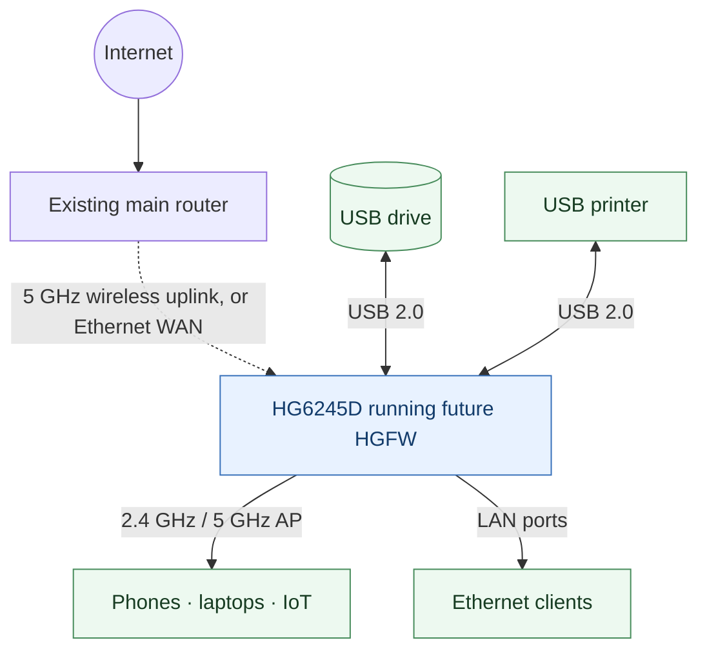
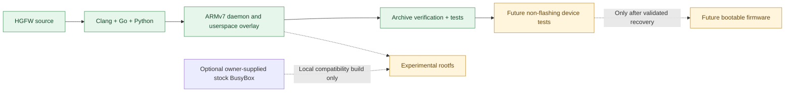

# HGFW — HG6245D Custom Firmware

[](https://github.com/Kyne0328/pldt-hd6245d-custom-firmware/actions/workflows/ci.yml)

**An open, community-oriented firmware project to repurpose the FiberHome HG6245D as a capable router and network appliance.**

The aim is to use as much of the device's existing hardware as possible: dual-band Wi-Fi, Ethernet routing, USB storage, printer sharing, and an independent administration interface.

> [!IMPORTANT]
> **Developer preview — not ready to install.** The project now builds a native ARMv7 management daemon, an authenticated browser dashboard and a reproducible userspace overlay. However, it is **not** a complete router operating system, bootable kernel, or flashable image. No generated archive should be flashed to a device.

## The goal



This diagram is the **planned system**, not an assertion that the current code already implements these connections. GPON operation is optional because the project targets retired/deactivated units.

### Target hardware

| Component | Findings |
| --- | --- |
| Device | FiberHome HG6245D, RP2613 hardware/firmware variant |
| SoC | Broadcom BCM96846 (`brcm,bcm96846` device-tree compatible) |
| CPU / OS baseline | ARMv7, original Broadcom Linux 4.1.45 |
| RAM | Approximately 208 MiB visible to the stock Linux kernel |
| Wi-Fi | 2.4 GHz and 5 GHz Broadcom radios; AP mode verified, client capability advertised but not yet tested end-to-end |
| Ethernet | Four LAN ports; switch and per-port routing still to be validated |
| USB | Two physical ports verified to enumerate a removable USB mass-storage device at USB 2.0 high-speed |
| Flash | NAND / UBI / UBIFS with two firmware slots; bootloader and safe recovery behavior not yet established |

Hardware capabilities verified on one board are not necessarily identical across all ISP/manufacturing variants.

## Progress

| Area | Status |
| --- | --- |
| Original firmware preservation / hardware investigation | Completed locally; private backups **not included** here |
| ARMv7 static cross-compilation | Working |
| Service supervisor (explicit configurations, bounded restarts and shutdown) | Implemented; host-tested |
| Password-protected local dashboard and live device status | **Verified on physical BCM96846:** authenticated loopback HTTP/API (`SMOKE_EXIT=0`), plus real-browser HTTPS login and dashboard on LAN (`PREVIEW_EXIT=0`, timed shutdown, Oct 12, 2026). |
| USB device detection and opt-in read-only mount/unmount CLI | Implemented; hardware access not yet tested with HGFW |
| Network Engine v1 (read-only) | **Verified on physical BCM96846:** kernel IPv4 route/bridge/link/traffic inventory (`INSPECT_EXIT=0`); loopback health responder launched, checked and cleanly stopped by process supervisor (`SELFTEST_EXIT=0`), October 12, 2026. Network configuration changes not tested or enabled. |
| Reproducible userspace overlay + checksums | Working; additional host-only `tools/build_release.sh` builds, tests, QEMU-checks and hashes a single ARMv7 softfloat release candidate. |
| Offline Python and Go test suites | Working |
| Native execution on the HG6245D | **Stage 2 softfloat ARMv7 binary verified on physical BCM96846**: `version`, `status`, and `usb` each returned exit code 0 from RAM-backed tmpfs (Oct 12, 2026). Initial hardfloat build was incompatible; `GOARM=7,softfloat` fixed it. |
| Ethernet WAN, firewall, DHCP and DNS | Read-only interface/route/resolver inspection; optional Wi-Fi/ARP IPv4 evidence correlation. A small **independent static DNS responder** is executable and host/ARM loopback-tested without using port 53. DHCP server, LAN DNS activation, firewall and routing changes are **not enabled**. |
| Wireless client / repeater modes | **Read-only wireless inventory verified on physical BCM96846 (Oct 12, 2026):** driver association counts and authenticated browser client rows on both radios, owner-confirmed valid SSID, per-station RSSI, RX and TX link rates. Independent Wi-Fi client/STA/repeater configuration remains unsupported. |
| SMB/NAS file sharing | Planned |
| USB printer server | Planned; requires printer compatibility testing |
| Independent admin UI | Eight-view router console: Overview, Status, Network, Security, Applications/VPN, Management, USB Storage, and Services; live kernel diagnostics plus explicit unimplemented states. **HGFW v3 authenticated HTTPS browser and wireless-client table verified on physical BCM96846 (Oct 12, 2026).** |
| Bootable custom image / safe installer | Blocked by boot-chain and recovery validation |

### Loopback dashboard smoke test

Run `hgfw smoke` with the native host executable or the ARMv7 executable. It starts the real admin HTTP handler on an **OS-assigned loopback-only TCP port**, uses a temporary random password held only in memory, and checks anonymous access denial, login, protected dashboard and JSON API, CSRF enforcement, logout revocation, server shutdown, and process memory usage. It writes no credentials, makes no router configuration changes, and prints a JSON summary without passwords or device MAC addresses.

```sh
./build/hgfw-host smoke
# For an HG6245D, run the verified ARM softfloat binary from tmpfs:
# /mnt/hgfw-run/hgfw smoke
```

The full end-to-end smoke test passed on **both the no-VFP ARM emulator and a physical HG6245D** running stock Broadcom Linux 4.1.45 (October 12, 2026). The physical test returned `SMOKE_EXIT=0`, all seven security/lifecycle checks true, 37 interfaces, two USB block-device entries (one disk and one partition), 12,020 KiB peak RSS, and 9,647 ms elapsed. It used `127.0.0.1:ephemeral` and automatically shut down. This establishes backend behavior, not browser rendering, long-running reliability, full USB filesystem support, router/network configuration control, or an independently bootable firmware. Because it binds to the router's 127.0.0.1, it is intentionally not browsable from another computer on the LAN.

### Temporary HTTPS browser preview (engineering validation)

To view the real HGFW dashboard from another LAN computer, stage the ARMv7 executable on the router using a RAM-backed filesystem and a SHA-256 checked transfer. The source includes `hgfw preview`, which **never modifies network configuration** and does not install any boot service. With the router's example LAN management address:

```sh
/mnt/hgfw-run/hgfw preview --listen 192.168.1.2:9443 --seconds 240
```

The preview binds only to an IPv4 address already assigned to the device; wildcard binds are refused. It creates a fresh TLS key/certificate and strong random password **in memory**, prints the temporary `https://` URL, password and certificate SHA-256 fingerprint to the terminal, and shuts down automatically after 240 seconds (or sooner on Ctrl-C). HTTPS clients will warn because the certificate is self-signed. Verify the certificate fingerprint independently against the terminal before proceeding; do not permanently trust the certificate. Never share the printed one-time password or commit credentials to Git.

**Physical-device browser test verified (October 12, 2026):** The operator successfully opened the HTTPS login and dashboard from a Windows browser with the preview running on the stock HG6245D. The router returned `HGFW_PREVIEW_STOPPED=true`, `HGFW_PREVIEW_ELAPSED_SECONDS=244`, `HGFW_PREVIEW_PEAK_RSS=12500 kB` (about 12.2 MiB), and `PREVIEW_EXIT=0`. This verifies actual browser access and timed process exit, not long-term stability or independence from the vendor OS. The dashboard is observation-only. The command does not run router services, DHCP, firewall configuration, flash utilities or USB mounts. Afterward it prints elapsed runtime and its peak resident memory reported by the kernel. This is a bounded LAN demonstration of the **actual** management UI, not a deployed router OS. Do not expose the preview port through a WAN or port-forwarding rule.

### Verified non-flashing hardware test

On a physical HG6245D running stock RP2613 Linux 4.1.45, the independently built HGFW Stage 2 ARMv7 binary was SHA-256 verified, copied to a temporary RAM-backed filesystem, and executed without a firmware change. The `version`, `status`, and `usb` commands all completed with exit code 0. `status` identified `Broadcom BCM96846` and enumerated stock Ethernet, switch and dual-band Wi-Fi interfaces; `usb` enumerated a removable disk and partition. The binary and temporary mount were removed afterward.

**Scope:** These were read-only device-inventory commands. Separate follow-up tests successfully verified the authenticated dashboard on physical hardware, but did not verify USB filesystem mounting, process supervision, router control, a new-kernel boot, or flash recovery. Device-specific network MAC addresses, passwords and raw console transcripts are intentionally not published.

## Architecture and development path



A complete modern Linux/OpenWrt-style port is the long-term direction. Broadcom's proprietary wireless/switching dependencies make modern-kernel support a substantial engineering challenge. A compatibility userspace on the original kernel is a development stepping stone—not a secure, finished firmware release.

## Build

**Requirements:** Linux or WSL2, Go 1.26+, Python 3.9+, GNU Make, Bash, Clang with ARM target support, and LLD. Install Go from [go.dev/dl](https://go.dev/dl/) or an equivalent trusted package source. On Ubuntu 24.04, install the remaining tools:

```bash
sudo apt-get install -y python3 make clang lld
# Ensure `go version` reports Go 1.26 or newer.
git clone https://github.com/Kyne0328/pldt-hd6245d-custom-firmware.git
cd pldt-hd6245d-custom-firmware
make all
```

`make all` cross-builds both the original ARM canary and a statically linked ARMv7 HGFW management daemon using **`GOARM=7,softfloat`**, assembles the overlay, verifies integrity and runs the Python and Go tests. **The build does not contact or modify any router.**

The outputs are generated under `dist/`:

- `hgfw-stage2-armv7-overlay.tar.gz` — nonbootable ARMv7 userspace overlay containing the HGFW daemon, canary, default configuration and read-only diagnostics.
- `manifest.json` and `*.sha256` — build metadata and integrity checks.

### HGFW console redesign

The management interface is now a proper responsive, four-view router console rather than one long inventory page. **Overview** shows a local management/network diagram, measured RAM utilization, uptime, load, wireless radio presence, USB disk counts and key device summaries. **Network** has searchable, filterable Broadcom/Linux interfaces with state, IP, MAC and MTU; **USB storage** distinguishes disks, partitions and actual mounts; **Services** shows the supervisor's live process states or a truthful empty state. Views work on mobile and desktop, refresh live every 15 seconds, and remain accessible without a third-party font, JS library or internet connection. All content is rendered from the authenticated read-only status API. Interface presence is not presented as internet connectivity or proof of control over drivers. A visual browser test of the redesigned version on the physical router is still pending.

### Wireless Engine v1 and VPN kernel assessment

`hgfw wireless-inspect` and the authenticated **Status -> Wi-Fi clients / 2.4 GHz / 5 GHz** pages now attempt *strictly read-only* native association queries: the Broadcom `wl -i wlN assoclist` driver helper when present, or `iw dev wlN station dump` for compatible nl80211 drivers. Radio SSID and channel are read through permitted `wl ... ssid/channel` or `iw ... info` queries only when the helper responds. Each command has a 900 ms timeout, an output bound and fixed arguments. Neither helper is bundled in HGFW. The extracted original application partition did **not** include a standalone `wl` or `iw` executable, although its proprietary `webs` webserver references a native Wi-Fi station enumeration routine; the *running* HG6245D **does** expose a working `wl` helper for the strictly read-only `assoclist` query, as confirmed by the October 12 physical test. A missing/unsupported driver query is reported as **unavailable**, not as zero connected stations. Never interpret IPv4 ARP neighbors as authenticated Wi-Fi associations. Associated MAC addresses are shown only in the authenticated dashboard/explicit local CLI output; do not post raw client lists publicly.

`hgfw vpn-inspect` and **Applications -> VPN overview** distinguish the TUN character node, kernel `/proc/misc` TUN registration, available module/sysfs evidence, optional `/proc/config.gz` or `/boot/config-*` `CONFIG_TUN`/`CONFIG_WIREGUARD` flags and presence of `/proc/net/xfrm_stat`. A bounded kernel-config reader extracts just these booleans. No TUN device is opened, no `TUNSETIFF` ioctl is invoked and no kernel modules or routes are changed. This is **VPN feasibility evidence**, not a working VPN tunnel, keys or authenticated server/client.

Read-only commands for a RAM-only HG6245D hardware test (the JSON can contain Wi-Fi MACs and an SSID, so redact before sharing):

```sh
/mnt/hgfw-run/hgfw wireless-inspect
/mnt/hgfw-run/hgfw vpn-inspect
```

**Physical test (October 12, 2026):** after hash-verifying ARMv7 softfloat binary SHA-256 `6a4d56cc3ba90b0dfdad9f3b62c9585625c8ac137e18dce468bb806dd0d5b246` in a 12 MiB dedicated tmpfs, `wireless-inspect` returned `WIRELESS_EXIT=0`, `associationStatus=observed` for both `wl0` (1 station) and `wl1` (2 stations). The tool reported channels 9 and 58. The driver returned a one-character SSID on both radios; the device owner subsequently confirmed this is the actual configured network name. The name is intentionally omitted here for privacy. No RSSI/rate measurements were obtained from `assoclist`. `vpn-inspect` returned `VPN_EXIT=0` and observed **no TUN character device**, **no TUN registration**, and reported `CONFIG_TUN=disabled`, with `CONFIG_WIREGUARD=unknown`, no WireGuard module observed and only `pppd` detected. IPv4 forwarding was off, IPv6 forwarding on. This means the stock kernel does not currently provide a demonstrated TUN-based path for userspace WireGuard/OpenVPN. No station MACs or private SSIDs are included in this public record. Actual VPN deployment requires different kernel/driver support or a separately validated alternative, along with secure key storage, routing and verified recovery. No flash or current network configuration changes occur.
### Wireless Engine v2 — optional station signal and rates

The independent wireless inspector now supplements a successful Broadcom `wl assoclist` with read-only `wl -i wlN sta_info <station-MAC>` (last TX/RX packet rates) and `wl -i wlN rssi <station-MAC>` (RSSI). Output is strictly parsed and converted to MBit/s and dBm, respectively. Unsupported commands, malformed responses, or missing driver values remain unavailable; even a helper that prints an error on stdout and exits successfully cannot be misreported as zero clients. A valid association list is never discarded because optional enrichment failed. The enrichment phase runs **after both radios' base inventories**, checks at most eight associated clients across radios in a round-robin order, and has a combined 2.5-second time budget on top of the original 900-ms-per-command limits. Each displayed station still originates solely from a driver association query, never from ARP, leases, or inferred device names.

SSID parsing now requires a recognized one-line `Current SSID:` or `SSID:` response and rejects invalid quoting/control bytes or SSIDs longer than 32 bytes. The device owner confirmed that the observed one-character SSID is the actual network name; this is valid under the SSID format and was parsed correctly by HGFW. No device-side correction or additional raw-SSID probe is required. The v2 code passed local Go tests, Go vet, JavaScript syntax checks, ARMv7 soft-float QEMU and authenticated lifecycle smoke testing. **Physical test (October 12, 2026, owner-reported):** `wireless-inspect` on the BCM96846 HG6245D returned successful Broadcom driver association inventories for both `wl0` (zero associated stations at this snapshot; channel 3) and `wl1` (three associated stations; channel 58). All three 5 GHz stations reported driver RSSI values (-62, -76 and -39 dBm) and AP-perspective RX link rates (6, 6 and 866.667 MBit/s). HGFW did **not report TX link rates in that snapshot**. In a later, separate read-only `wl sta_info` diagnostic on October 12, the owner observed one 5 GHz station's TX rate at **195000 kbps (195 MBit/s)** and RX rate at **6000 kbps (6 MBit/s)**. This confirms that the running Broadcom driver can report a TX rate, independently of HGFW's original parser. A later raw-line-only diagnostic confirmed the cause: the physical Broadcom helper emits a paired TX rate such as `rate of last tx pkt: 292500 kbps - 97500 kbps`, while the v2 parser initially required the line to end after the first `kbps`. The parser now accepts an optional ` - <number> <unit>` suffix for last-packet rates, reports **only the primary rate**, and deliberately does not guess the meaning of the second value. The observed RX line remained a simple single rate. The v3 parser correction passed local regression tests and was subsequently verified on the physical HG6245D as documented below. No station MACs or SSIDs are recorded. Both radios returned the same one-character SSID, confirmed by the device owner to be the real configured name; the parser result is therefore correct, not a defect. Counts/channels are point-in-time observations and can change without HGFW modifying settings. This physical report corroborates v2 station signal/rate extraction, **not** firmware-independent boot, Wi-Fi configuration control, internet throughput, or a completed dashboard browser test. No station MAC addresses or private SSIDs are published. No firmware flashing, network reconfiguration or device reboot is supported.

### Wireless Engine v3 — TX rate fix verified on hardware

**Physical verification (October 12, 2026, owner-reported):** the owner transferred the ARMv7 softfloat build `hgfw-armv7-v3-tx` to the existing RAM-only `/mnt/hgfw-run/hgfw` path, then ran `wireless-inspect` only after its SHA-256 matched `e3fe1a2bd149648d2f2e3eb04735910ab6fb24eabbfe2e901a56efbd28702f14`. Output included `rxBitrate` and `txBitrate` fields for each of three observed wireless stations: (RX 6, TX 390), (RX 650, TX 433.333), and (RX 175.5, TX 325), all in MBit/s. This verifies that the paired-rate Broadcom TX parsing correction works on the real HG6245D. These values are point-in-time driver-reported link rates, not measured internet throughput. No client MACs, network names, or credentials are included in this record. The CLI verification alone did not establish browser-dashboard rendering; that was subsequently verified as described below. Long-term performance, control over stock Wi-Fi configuration, and independent firmware boot remain unverified. No NAND flash, router reboot, or network configuration change was performed by the test commands.

**Authenticated browser verification (October 12, 2026, owner-reported):** the operator opened the v3 temporary HTTPS preview from a Windows PC, successfully signed in, and viewed the **Status -> Wi-Fi clients list**. The page displayed one associated 2.4 GHz station and two associated 5 GHz stations with individual client rows; **all three rows visibly included RSSI, RX link rate and TX link rate** (2.4 GHz: -59 dBm, RX 1, TX 72.222 MBit/s; 5 GHz: -39 dBm, RX 866.667, TX 433.333 MBit/s; -68 dBm, RX 260, TX 325 MBit/s). These are transient diagnostic measurements and are not internet throughput. No client addresses, SSID values, screenshots or preview passwords are published. This verifies the actual wireless client display, not just the backend CLI, while longer-running reliability and independent network configuration remain untested. The browser test was observation-only.

### Integrated Network Engine milestone (hardware browser observations; additional source discovery pending)

The next HGFW development build adds several independently implemented, safely bounded components rather than enabling unverified stock-router writes. **Wi-Fi/ARP correlation:** the authenticated station listing now attaches a separately observed IPv4 neighbor only if the station was actually reported by the Wi-Fi driver and a matching complete kernel ARP entry exists on its same interface or observed bridge master. Ambiguous, unavailable, cross-interface and conflicting matches stay unknown. ARP is explicitly **not** a DHCP lease, friendly name, or proof of connectivity. **Resolver inventory:** HGFW reads only recognized IP addresses from the Linux resolver file, bounded and without publishing search domains; these OS resolver entries do not prove working upstream DNS or DHCP-advertised DNS.

**Independent DNS core:** a constrained static A-record responder for the synthetic `hgfw.test` test name is implemented using the Go standard library. Its end-to-end UDP selftest binds only an OS-selected `127.0.0.1` port, validates a local A response and refusal of a foreign name, then closes; it does not forward traffic, bind port 53, install a service, or modify the router's DNS settings. `dns-selftest` runs this service independently. This validates a real userspace DNS protocol response on loopback, **not** an operational LAN DHCP/DNS replacement.

**Optional client labels:** a small, bounded reader understands the standard dnsmasq five-field lease file at `/var/lib/misc/dnsmasq.leases` **only if a regular file exists there**; the proprietary stock DHCP service is not assumed to use this format or path. Host labels are attached in the authenticated Wi-Fi table only when a current validated lease MAC+IPv4 matches both an actual wireless association and a separate ARP IPv4 observation. Conflicting entries, expired leases and invalid host labels are withheld. These labels are user-visible hints, **not verified device identity or proof of DHCP service ownership**. Unavailable evidence stays unavailable. No vendor backup files or passwords are read.

**Network planning safety:** the offline DHCP pool validator now rejects any range that *spans* the configured gateway address, not only ranges with a conflicting endpoint. Hardware interface selection, apply/rollback, lease persistence, DHCP packet service, and flash-independent recovery remain pending.

**Single-field-session diagnostic:** `hgfw field-check` collects only aggregate counts for radios, associations, RSSI, RX/TX, observed ARP neighbors and conservative matches, routes, resolvers and USB devices, then runs the bounded DNS loopback selftest, supervised loopback HTTP test, and authenticated admin security smoke test. Its JSON deliberately omits MAC addresses, SSIDs, IP addresses, usernames, passwords and client names. Subprocesses stop before exit and no LAN port/service or network setting is modified. Run the same compiled binary under an authenticated, RAM-only console; do not publish raw `hgfw status` or browser client lists. Field-check success does **not** imply working WAN, DNS on LAN, DHCP allocation, flash recovery or a completed browser integration test.

For development on WSL, `GO=/path/to/go QEMU_ARM=/path/to/qemu-arm-static sh tools/build_release.sh` runs Go regression and vet, Python tests, JS syntax (if Node installed), host field-check, ARM build and optional QEMU ARM smoke/DNS tests, then prints the binary's SHA-256. `tools/hgfw_send.py` supplies a one-shot, peer-restricted LAN binary transfer to a router-initiated netcat receiver. The build and sender cannot flash or configure the router. Only a checksum-matching binary should ever be executed from RAM. **Owner-reported physical browser observation (October 12, 2026):** the integrated dashboard authenticated successfully and displayed four 5 GHz associations with RSSI and RX/TX rates, no 2.4 GHz associations, one kernel ARP entry and zero Wi-Fi/ARP joins. The standard dnsmasq lease path and Linux resolver file were unavailable to HGFW. This does not establish missing or broken stock DHCP/DNS service; the actual service processes, sockets and private vendor data sources are not yet verified. The independent loopback DNS test and combined `field-check` on physical hardware remain to be verified. No MACs, SSIDs or client IPs from the report are published.

**Follow-up source discovery:** HGFW now checks only a fixed set of common resolver/lease paths for metadata (no file contents or symlink targets), allowlisted DHCP/DNS process names from `/proc/*/comm` (no arguments), and kernel socket port numbers 53 and 67 (no endpoint addresses). These observations are shown in the authenticated DNS/DHCP evidence views, and aggregate counters and allowlisted names appear in `field-check`. Path presence, a process name or a socket port is **not** evidence of a configured or usable DNS/DHCP server. This discovery is locally tested but awaits the next RAM-only physical run.

### Full router-console feature map (Stage 2 read-only)

HGFW now uses the **five original PLDT administration areas** as an independently implemented navigation framework: **Status**, **Network**, **Security**, **Applications**, and **Management**. Existing **Overview**, **USB Storage**, and **Services** remain available. This structure was derived from offline analysis of the private stock menu XML and matching ASP entry points, **not** from copying vendor JavaScript or compiled binaries into HGFW. The original Wi-Fi client table was traced to `wireless/wifimaclist.asp` and a compiled `getWifiMac_IPListParam` handler. Stock GRE and IPsec pass-through pages submit to private `/goform/setVPNEnable` and `/goform/setIpsecEnable`; neither page proves VPN server availability.

- **Live, authenticated observations:** device model, kernel, memory, uptime, Linux/bridge/WAN route evidence, available carrier readings, an operator-reported LAN 1-4 map on BCM96846 only, completed ARP neighbor entries, USB disks, HGFW process supervisor, kernel IPv4/IPv6 forwarding flags, available firewall table names, VPN executable inventory, and TUN/WireGuard kernel/device presence.
- **Features not yet independently enabled:** independent Wi-Fi association policy or SSID/WPA/5 GHz radio configuration, WAN/DHCP/IPTV/IPv6 configuration, VPN pass-through toggles, WireGuard/OpenVPN tunnels, firewall/parental filtering, NAT/port forwarding/UPnP/DDNS, SMB/printing, account/password changes, logging/clock, backups/restores, firmware update and reboot. They have navigable explanations and prerequisites, **not working Apply buttons**.
- **Safety boundary:** The dashboard neither submits stock CGI calls nor executes router configuration/flash commands. VPN diagnostics are capability signals, **not an active VPN connection**. Original stock source and private backups remain outside the public repository.

This milestone implements the **router-administration information architecture with safe diagnostics**, not functional parity with stock firmware. Each configuration service still needs independent driver/backend integration, tests and a proven software-only rollback/recovery mechanism. The current integrated dashboard has been observed in a real authenticated browser on HG6245D; the additional source-discovery build and complete `field-check` are not yet physically verified.
### Network Engine v1 — inspection, validation, supervised loopback

The Stage 2 backend now supplies a `device.network` object in authenticated `/api/status` and `hgfw status`. Its kernel evidence comes from `/sys/class/net` and `/proc/net/route`, including interface role labels with explicit **confidence**, bridge master (when exposed), operative state, carrier (when available), link speed (when available), RX/TX counters and IPv4 routes. The Network page displays these observed values and highlights the active default IPv4 route where one exists. The engine **does not map physical LAN jack numbers** and does **not verify** Wi-Fi AP/STA mode or actual internet access; vendor-named `wan0` and GPON interfaces are not assumed functional WAN ports.

```sh
hgfw network-inspect
hgfw network-plan --config config/network.example.json
hgfw network-plan --config config/network.example.json --check-device
hgfw network-selftest
```

`network-plan` validates interface-name safety, non-optical interface choices, LAN CIDR and a DHCP range excluding the router IP, subnet address and broadcast address. `--check-device` additionally requires the selected interface names to exist in the running Linux inventory and will reject the example plan on devices where those hypothetical names do not exist. **No plan is applied.** These checks do not prove routing, firewall or hardware driver feasibility.

`network-selftest` starts a dedicated temporary health responder on an OS-selected `127.0.0.1` port through HGFW's existing independent process supervisor, checks the loopback HTTP response and waits for clean termination. The command produces JSON (`success`, `responseVerified`, `supervised`, `stopped`). This is *loopback-bound process isolation*, not a new Linux network namespace or a router DHCP/DNS service. It never changes interfaces, bridges, routes, DNS, WAN, wireless or flash, and the child has a 25-second upper time limit. **Physical BCM96846 validation (October 12, 2026):** After transfer to a 12 MiB RAM-only tmpfs and SHA-256 verification, `network-inspect` returned `INSPECT_EXIT=0`. The kernel identified `br0` as a Linux bridge; `eth0.0`, `eth1.0`, `eth2.0`, `eth3.0`, `wl0` and `wl1` were among its members. `eth0` and `eth3` reported carrier; `eth1` and `eth2` reported no carrier. Only one local IPv4 route, `192.168.1.0/24` via `br0`, appeared; no default IPv4 route was observed. The separate `network-selftest` returned `SELFTEST_EXIT=0`, with `success`, `responseVerified`, `supervised` and `stopped` all true (112 ms). RAM test artifacts were subsequently removed. This confirms read-only hardware inspection and a local supervised service, **not** the physical jack map, WAN connectivity, independent routing/DHCP/DNS, or a safe flash/recovery path. No device MAC addresses, private credentials or raw console dumps are published.

## Run the dashboard locally

First, build a **host** executable. Never run host binaries on the router.

```bash
make host
mkdir -p private
read -rsp "Choose a strong admin password: " HGFW_PASS; echo
(umask 077; printf '%s' "$HGFW_PASS" > private/admin-password)
unset HGFW_PASS
./build/hgfw-host init --password-file private/admin-password --auth-file private/admin.json
rm private/admin-password
./build/hgfw-host serve --listen 127.0.0.1:9080 --auth-file private/admin.json --services config/services.json
```

Open **http://127.0.0.1:9080** on the same development machine. The login has password-based authentication, an ephemeral session, a CSRF-protected sign-out and rate limiting. The dashboard shows live kernel network, RAM, and USB information from the machine **where the daemon actually runs**.

For a non-loopback listener, a TLS certificate and key must be configured; default HTTP is intentionally local-only. The web interface exposes **read-only** state and provides no NAND, Wi-Fi, or firewall write endpoints.

The CLI provides independent system inspection and an isolated LAN/WAN **plan** without applying it:

```bash
./build/hgfw-host status
./build/hgfw-host usb
./build/hgfw-host network-plan --config config/network.example.json
```

The service supervisor uses `config/services.json`, with an empty and disabled-by-default service list. Operators can explicitly add absolute executable paths and restart policies. External child processes run without a shell and are terminated when HGFW stops. USB mounting is available **only** through an explicit local CLI action that verifies a sysfs USB partition and mounts it read-only under a pre-provisioned directory; do not attempt that on the router until its automount behavior has been assessed.

Optional developer-only compatibility rootfs:

```bash
# Use a BusyBox ELF from firmware you personally own and have permission to inspect.
export HGFW_STOCK_BUSYBOX=/path/to/your/extracted/rootfs/bin/busybox
make compat
```

This *optional* archive incorporates the locally provided stock BusyBox; it is **not** redistributed by this project. It remains nonbootable and must not be flashed.

## Source layout

```text
.
├── .github/workflows/ci.yml    # Build and tests on every push/PR
├── Makefile                    # Reproducible host-only commands
├── cmd/hgfw/                  # Native Linux CLI + daemon
├── internal/                  # Admin, device, service and USB modules
├── config/                    # Explicit services + sample network plan
├── fwkit.py                    # Original userspace overlay builder/verifier
├── compat_rootfs.py            # Optional private compatibility build
├── src/
│   ├── arm/hello.S             # Minimal static ARMv7 syscall test
│   ├── etc/hgfw/               # Feature manifest and default settings
│   └── usr/sbin/               # Read-only hardware and USB diagnostics
├── tests/                      # Reproducibility and archive safety tests
└── tools/build_arm.sh          # ARM cross-build with Clang + LLD
```

Build output, extracted proprietary firmware, calibration data, private device settings and passwords are deliberately excluded from version control.

## Roadmap

1. **Hardware reference:** capture non-sensitive device-tree and kernel configuration structure, map Ethernet/switch functionality.
2. **Userland proof:** execute the ARMv7 test program in a temporary environment and confirm compatibility.
3. **Networking:** validate current interfaces and planned isolated WAN/LAN topologies; implement tested, rollback-protected DHCP/DNS, firewall and Wi-Fi controls.
4. **USB services:** verify the opt-in read-only mount flow on the device; add audited SMB/NFS file sharing and printer server support.
5. **Management:** extend the working authenticated observation dashboard with explicitly authorized safe control operations, logs, backups and update/rollback management.
6. **Firmware release:** implement verified boot/recovery and produce a flashable image only after safe failure recovery is established.

## Safety and legal notes

- **Nothing in this repository should be flashed or installed over an active firmware image.** An unsafe image can permanently prevent software-only recovery.
- Proprietary Broadcom/FiberHome components, original NAND backups, and device-specific credentials are not published.
- The original Linux 4.1 kernel is obsolete; a compatibility approach must not be treated as safe for internet-facing production deployment.
- HGFW is an independent community project, **not affiliated with or endorsed by FiberHome, Broadcom, or PLDT**.
- No license has been selected yet. Until a license is added, the default copyright rules apply to these source files.
