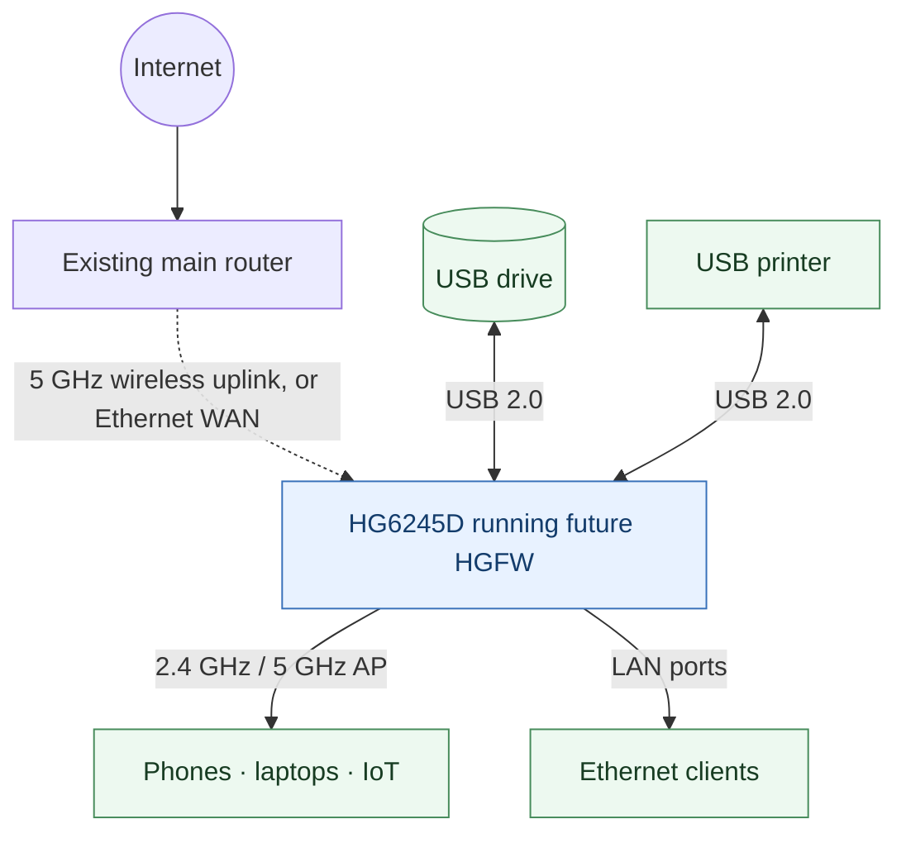
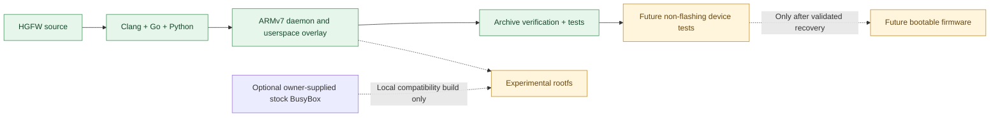

# HGFW — HG6245D Custom Firmware

[](https://github.com/Kyne0328/pldt-hd6245d-custom-firmware/actions/workflows/ci.yml)

**An open, community-oriented firmware project to repurpose the FiberHome HG6245D as a capable router and network appliance.**

The aim is to use as much of the device's existing hardware as possible: dual-band Wi-Fi, Ethernet routing, USB storage, printer sharing, and an independent administration interface.

> [!IMPORTANT]
> **Developer preview — not ready to install.** The project now builds a native ARMv7 management daemon, an authenticated browser dashboard and a reproducible userspace overlay. However, it is **not** a complete router operating system, bootable kernel, or flashable image. No generated archive should be flashed to a device.

## The goal



This diagram is the **planned system**, not an assertion that the current code already implements these connections. GPON operation is optional because the project targets retired/deactivated units.

### Target hardware

| Component | Findings |
| --- | --- |
| Device | FiberHome HG6245D, RP2613 hardware/firmware variant |
| SoC | Broadcom BCM96846 (`brcm,bcm96846` device-tree compatible) |
| CPU / OS baseline | ARMv7, original Broadcom Linux 4.1.45 |
| RAM | Approximately 208 MiB visible to the stock Linux kernel |
| Wi-Fi | 2.4 GHz and 5 GHz Broadcom radios; AP mode verified, client capability advertised but not yet tested end-to-end |
| Ethernet | Four LAN ports; switch and per-port routing still to be validated |
| USB | Two physical ports verified to enumerate a removable USB mass-storage device at USB 2.0 high-speed |
| Flash | NAND / UBI / UBIFS with two firmware slots; bootloader and safe recovery behavior not yet established |

Hardware capabilities verified on one board are not necessarily identical across all ISP/manufacturing variants.

## Progress

| Area | Status |
| --- | --- |
| Original firmware preservation / hardware investigation | Completed locally; private backups **not included** here |
| ARMv7 static cross-compilation | Working |
| Service supervisor (explicit configurations, bounded restarts and shutdown) | Implemented; host-tested |
| Password-protected local dashboard and live device status | **Verified on physical BCM96846:** authenticated loopback HTTP/API (`SMOKE_EXIT=0`), plus real-browser HTTPS login and dashboard on LAN (`PREVIEW_EXIT=0`, timed shutdown, Oct 12, 2026). |
| USB device detection and opt-in read-only mount/unmount CLI | Implemented; hardware access not yet tested with HGFW |
| Network Engine v1 (read-only) | Implemented: kernel IPv4 routes, sysfs link/carrier/traffic/bridge data, confidence-labeled driver roles, device-presence plan checks, supervised loopback service test; physical-device test pending |
| Reproducible userspace overlay + checksums | Working |
| Offline Python and Go test suites | Working |
| Native execution on the HG6245D | **Stage 2 softfloat ARMv7 binary verified on physical BCM96846**: `version`, `status`, and `usb` each returned exit code 0 from RAM-backed tmpfs (Oct 12, 2026). Initial hardfloat build was incompatible; `GOARM=7,softfloat` fixed it. |
| Ethernet WAN, firewall, DHCP and DNS | Planned |
| Wireless client / repeater modes | Under investigation |
| SMB/NAS file sharing | Planned |
| USB printer server | Planned; requires printer compatibility testing |
| Independent admin UI | Redesigned read-only console with Overview, Network, USB Storage, and Services views; desktop/mobile host-browser tested. Revised visual design awaiting physical-device retest. |
| Bootable custom image / safe installer | Blocked by boot-chain and recovery validation |

### Loopback dashboard smoke test

Run `hgfw smoke` with the native host executable or the ARMv7 executable. It starts the real admin HTTP handler on an **OS-assigned loopback-only TCP port**, uses a temporary random password held only in memory, and checks anonymous access denial, login, protected dashboard and JSON API, CSRF enforcement, logout revocation, server shutdown, and process memory usage. It writes no credentials, makes no router configuration changes, and prints a JSON summary without passwords or device MAC addresses.

```sh
./build/hgfw-host smoke
# For an HG6245D, run the verified ARM softfloat binary from tmpfs:
# /mnt/hgfw-run/hgfw smoke
```

The full end-to-end smoke test passed on **both the no-VFP ARM emulator and a physical HG6245D** running stock Broadcom Linux 4.1.45 (October 12, 2026). The physical test returned `SMOKE_EXIT=0`, all seven security/lifecycle checks true, 37 interfaces, two USB block-device entries (one disk and one partition), 12,020 KiB peak RSS, and 9,647 ms elapsed. It used `127.0.0.1:ephemeral` and automatically shut down. This establishes backend behavior, not browser rendering, long-running reliability, full USB filesystem support, router/network configuration control, or an independently bootable firmware. Because it binds to the router's 127.0.0.1, it is intentionally not browsable from another computer on the LAN.

### Temporary HTTPS browser preview (engineering validation)

To view the real HGFW dashboard from another LAN computer, stage the ARMv7 executable on the router using a RAM-backed filesystem and a SHA-256 checked transfer. The source includes `hgfw preview`, which **never modifies network configuration** and does not install any boot service. With the router's example LAN management address:

```sh
/mnt/hgfw-run/hgfw preview --listen 192.168.1.2:9443 --seconds 240
```

The preview binds only to an IPv4 address already assigned to the device; wildcard binds are refused. It creates a fresh TLS key/certificate and strong random password **in memory**, prints the temporary `https://` URL, password and certificate SHA-256 fingerprint to the terminal, and shuts down automatically after 240 seconds (or sooner on Ctrl-C). HTTPS clients will warn because the certificate is self-signed. Verify the certificate fingerprint independently against the terminal before proceeding; do not permanently trust the certificate. Never share the printed one-time password or commit credentials to Git.

**Physical-device browser test verified (October 12, 2026):** The operator successfully opened the HTTPS login and dashboard from a Windows browser with the preview running on the stock HG6245D. The router returned `HGFW_PREVIEW_STOPPED=true`, `HGFW_PREVIEW_ELAPSED_SECONDS=244`, `HGFW_PREVIEW_PEAK_RSS=12500 kB` (about 12.2 MiB), and `PREVIEW_EXIT=0`. This verifies actual browser access and timed process exit, not long-term stability or independence from the vendor OS. The dashboard is observation-only. The command does not run router services, DHCP, firewall configuration, flash utilities or USB mounts. Afterward it prints elapsed runtime and its peak resident memory reported by the kernel. This is a bounded LAN demonstration of the **actual** management UI, not a deployed router OS. Do not expose the preview port through a WAN or port-forwarding rule.

### Verified non-flashing hardware test

On a physical HG6245D running stock RP2613 Linux 4.1.45, the independently built HGFW Stage 2 ARMv7 binary was SHA-256 verified, copied to a temporary RAM-backed filesystem, and executed without a firmware change. The `version`, `status`, and `usb` commands all completed with exit code 0. `status` identified `Broadcom BCM96846` and enumerated stock Ethernet, switch and dual-band Wi-Fi interfaces; `usb` enumerated a removable disk and partition. The binary and temporary mount were removed afterward.

**Scope:** These were read-only device-inventory commands. Separate follow-up tests successfully verified the authenticated dashboard on physical hardware, but did not verify USB filesystem mounting, process supervision, router control, a new-kernel boot, or flash recovery. Device-specific network MAC addresses, passwords and raw console transcripts are intentionally not published.

## Architecture and development path



A complete modern Linux/OpenWrt-style port is the long-term direction. Broadcom's proprietary wireless/switching dependencies make modern-kernel support a substantial engineering challenge. A compatibility userspace on the original kernel is a development stepping stone—not a secure, finished firmware release.

## Build

**Requirements:** Linux or WSL2, Go 1.26+, Python 3.9+, GNU Make, Bash, Clang with ARM target support, and LLD. Install Go from [go.dev/dl](https://go.dev/dl/) or an equivalent trusted package source. On Ubuntu 24.04, install the remaining tools:

```bash
sudo apt-get install -y python3 make clang lld
# Ensure `go version` reports Go 1.26 or newer.
git clone https://github.com/Kyne0328/pldt-hd6245d-custom-firmware.git
cd pldt-hd6245d-custom-firmware
make all
```

`make all` cross-builds both the original ARM canary and a statically linked ARMv7 HGFW management daemon using **`GOARM=7,softfloat`**, assembles the overlay, verifies integrity and runs the Python and Go tests. **The build does not contact or modify any router.**

The outputs are generated under `dist/`:

- `hgfw-stage2-armv7-overlay.tar.gz` — nonbootable ARMv7 userspace overlay containing the HGFW daemon, canary, default configuration and read-only diagnostics.
- `manifest.json` and `*.sha256` — build metadata and integrity checks.

### HGFW console redesign

The management interface is now a proper responsive, four-view router console rather than one long inventory page. **Overview** shows a local management/network diagram, measured RAM utilization, uptime, load, wireless radio presence, USB disk counts and key device summaries. **Network** has searchable, filterable Broadcom/Linux interfaces with state, IP, MAC and MTU; **USB storage** distinguishes disks, partitions and actual mounts; **Services** shows the supervisor's live process states or a truthful empty state. Views work on mobile and desktop, refresh live every 15 seconds, and remain accessible without a third-party font, JS library or internet connection. All content is rendered from the authenticated read-only status API. Interface presence is not presented as internet connectivity or proof of control over drivers. A visual browser test of the redesigned version on the physical router is still pending.

### Network Engine v1 — inspection, validation, supervised loopback

The Stage 2 backend now supplies a `device.network` object in authenticated `/api/status` and `hgfw status`. Its kernel evidence comes from `/sys/class/net` and `/proc/net/route`, including interface role labels with explicit **confidence**, bridge master (when exposed), operative state, carrier (when available), link speed (when available), RX/TX counters and IPv4 routes. The Network page displays these observed values and highlights the active default IPv4 route where one exists. The engine **does not map physical LAN jack numbers** and does **not verify** Wi-Fi AP/STA mode or actual internet access; vendor-named `wan0` and GPON interfaces are not assumed functional WAN ports.

```sh
hgfw network-inspect
hgfw network-plan --config config/network.example.json
hgfw network-plan --config config/network.example.json --check-device
hgfw network-selftest
```

`network-plan` validates interface-name safety, non-optical interface choices, LAN CIDR and a DHCP range excluding the router IP, subnet address and broadcast address. `--check-device` additionally requires the selected interface names to exist in the running Linux inventory and will reject the example plan on devices where those hypothetical names do not exist. **No plan is applied.** These checks do not prove routing, firewall or hardware driver feasibility.

`network-selftest` starts a dedicated temporary health responder on an OS-selected `127.0.0.1` port through HGFW's existing independent process supervisor, checks the loopback HTTP response and waits for clean termination. The command produces JSON (`success`, `responseVerified`, `supervised`, `stopped`). This is *loopback-bound process isolation*, not a new Linux network namespace or a router DHCP/DNS service. It never changes interfaces, bridges, routes, DNS, WAN, wireless or flash, and the child has a 25-second upper time limit. The test was first validated on the development host; BCM96846 runtime testing is separate.

## Run the dashboard locally

First, build a **host** executable. Never run host binaries on the router.

```bash
make host
mkdir -p private
read -rsp "Choose a strong admin password: " HGFW_PASS; echo
(umask 077; printf '%s' "$HGFW_PASS" > private/admin-password)
unset HGFW_PASS
./build/hgfw-host init --password-file private/admin-password --auth-file private/admin.json
rm private/admin-password
./build/hgfw-host serve --listen 127.0.0.1:9080 --auth-file private/admin.json --services config/services.json
```

Open **http://127.0.0.1:9080** on the same development machine. The login has password-based authentication, an ephemeral session, a CSRF-protected sign-out and rate limiting. The dashboard shows live kernel network, RAM, and USB information from the machine **where the daemon actually runs**.

For a non-loopback listener, a TLS certificate and key must be configured; default HTTP is intentionally local-only. The web interface exposes **read-only** state and provides no NAND, Wi-Fi, or firewall write endpoints.

The CLI provides independent system inspection and an isolated LAN/WAN **plan** without applying it:

```bash
./build/hgfw-host status
./build/hgfw-host usb
./build/hgfw-host network-plan --config config/network.example.json
```

The service supervisor uses `config/services.json`, with an empty and disabled-by-default service list. Operators can explicitly add absolute executable paths and restart policies. External child processes run without a shell and are terminated when HGFW stops. USB mounting is available **only** through an explicit local CLI action that verifies a sysfs USB partition and mounts it read-only under a pre-provisioned directory; do not attempt that on the router until its automount behavior has been assessed.

Optional developer-only compatibility rootfs:

```bash
# Use a BusyBox ELF from firmware you personally own and have permission to inspect.
export HGFW_STOCK_BUSYBOX=/path/to/your/extracted/rootfs/bin/busybox
make compat
```

This *optional* archive incorporates the locally provided stock BusyBox; it is **not** redistributed by this project. It remains nonbootable and must not be flashed.

## Source layout

```text
.
├── .github/workflows/ci.yml    # Build and tests on every push/PR
├── Makefile                    # Reproducible host-only commands
├── cmd/hgfw/                  # Native Linux CLI + daemon
├── internal/                  # Admin, device, service and USB modules
├── config/                    # Explicit services + sample network plan
├── fwkit.py                    # Original userspace overlay builder/verifier
├── compat_rootfs.py            # Optional private compatibility build
├── src/
│   ├── arm/hello.S             # Minimal static ARMv7 syscall test
│   ├── etc/hgfw/               # Feature manifest and default settings
│   └── usr/sbin/               # Read-only hardware and USB diagnostics
├── tests/                      # Reproducibility and archive safety tests
└── tools/build_arm.sh          # ARM cross-build with Clang + LLD
```

Build output, extracted proprietary firmware, calibration data, private device settings and passwords are deliberately excluded from version control.

## Roadmap

1. **Hardware reference:** capture non-sensitive device-tree and kernel configuration structure, map Ethernet/switch functionality.
2. **Userland proof:** execute the ARMv7 test program in a temporary environment and confirm compatibility.
3. **Networking:** validate current interfaces and planned isolated WAN/LAN topologies; implement tested, rollback-protected DHCP/DNS, firewall and Wi-Fi controls.
4. **USB services:** verify the opt-in read-only mount flow on the device; add audited SMB/NFS file sharing and printer server support.
5. **Management:** extend the working authenticated observation dashboard with explicitly authorized safe control operations, logs, backups and update/rollback management.
6. **Firmware release:** implement verified boot/recovery and produce a flashable image only after safe failure recovery is established.

## Safety and legal notes

- **Nothing in this repository should be flashed or installed over an active firmware image.** An unsafe image can permanently prevent software-only recovery.
- Proprietary Broadcom/FiberHome components, original NAND backups, and device-specific credentials are not published.
- The original Linux 4.1 kernel is obsolete; a compatibility approach must not be treated as safe for internet-facing production deployment.
- HGFW is an independent community project, **not affiliated with or endorsed by FiberHome, Broadcom, or PLDT**.
- No license has been selected yet. Until a license is added, the default copyright rules apply to these source files.
